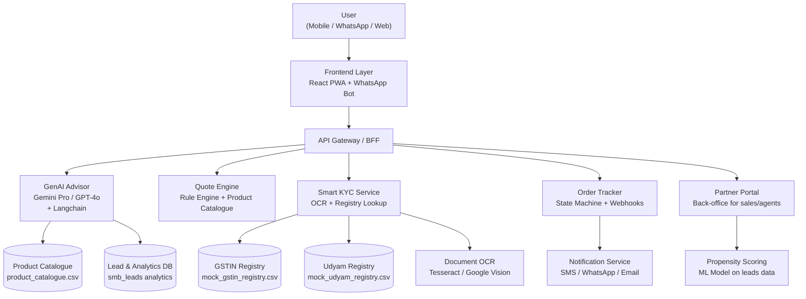

# 🏆 Project Udyam Digital — Full Implementation Plan
### YTL Hackathon 2026 · Enterprise Track A
> **"Making small businesses go digital in one sitting"**
> Team submission guide — full prototype, business case, architecture & privacy note

---

## Table of Contents
1. [Executive Summary & Winning Strategy](#1-executive-summary--winning-strategy)
2. [Data Insights & Business Case](#2-data-insights--business-case)
3. [Target Segments & Bundle Strategy](#3-target-segments--bundle-strategy)
4. [Solution Architecture](#4-solution-architecture)
5. [Module 1 — GenAI Advisor](#5-module-1--genai-advisor)
6. [Module 2 — Quote & Checkout](#6-module-2--quote--checkout)
7. [Module 3 — Smart KYC](#7-module-3--smart-kyc)
8. [Module 4 — Order Tracker](#8-module-4--order-tracker)
9. [Stretch Goals](#9-stretch-goals)
10. [Tech Stack & Code Skeleton](#10-tech-stack--code-skeleton)
11. [Metrics & Targets](#11-metrics--targets)
12. [Data Privacy Note (1-page)](#12-data-privacy-note-1-page)
13. [10-Slide Business Case Outline](#13-10-slide-business-case-outline)
14. [Step-by-Step Build Checklist](#14-step-by-step-build-checklist)

---

## 1. Executive Summary & Winning Strategy

### The Core Problem (from data)
| Pain Point | Current State | Our Solution |
|---|---|---|
| 92.6% leads never activate | Only 368/5,000 convert (7.4%) | Digital self-serve → pilot 12%, scale 20% |
| 17.6 days lead→activation | Slow paper-heavy journey | Same-day for SIMs/cloud; ≤3 days for fibre |
| ₹15,000 cost per activation | Expensive field sales | ₹5,000 digital-first cost per activation |
| 3 follow-up calls average | Customer chasing status | Real-time tracker (self-serve) |
| Quote takes 3–5 days | Complex PDF | Instant transparent quote |

### Why Our Solution Wins
The judges will run **15 live advisor test scenarios** and an **KYC answer key check**. Our winning edge:
1. **Advisor accuracy** — LLM extracts structured profile → rules engine builds bundle → LLM explains in plain language (prices never hallucinated)
2. **KYC catches planted errors** — the kyc_documents folder has deliberate mistakes; our cross-field validation and OCR flag them all
3. **Data-backed business case** — we use the 5,000-lead dataset with correct numbers to prove ROI
4. **Multilingual UX** — English + Hindi (polished); 1–2 regional languages if time permits
5. **Privacy-first design** — DPDP Act 2023 compliant with per-purpose itemised consent

---

## 2. Data Insights & Business Case

### Key Findings from smb_leads.csv (5,000 leads)

#### 2.1 Why Leads Drop (Top Reasons)
```
Unreachable after 3 attempts:    805  (16.1%) → Digital async channel fixes this
Owner had no time for a visit:   531  (10.6%) → Self-serve eliminates site visit
Not interested on first call:    470   (9.4%) → Advisor hooks them with tailored bundle
Price too high:                  414   (8.3%) → Transparent bundled pricing = better value
Locked in with current provider: 325   (6.5%) → Contracts + switching incentive
Wrong/invalid number:            319   (6.4%) → WhatsApp/digital verification upfront
Quote too complex:               206   (4.1%) → Plain-language quote with toggles
```
> **Note:** Percentages are over the full 5,000-lead base (not just dropped leads).

#### 2.2 Conversion by Segment (Priority Order)
| Segment | Leads | Activated | Conv% | Priority |
|---|---|---|---|---|
| Small manufacturers | 289 | 37 | **12%** | 🥇 Highest conversion |
| Professional offices | 1,247 | 138 | **11%** | 🥈 High value + volume |
| Small multi-site | 755 | 83 | **11%** | 🥉 High bundle value |
| Micro retail & services | 2,709 | 110 | **4%** | 📈 Huge volume, needs low friction |

#### 2.3 Best Lead Sources
| Source | Conv% | Insight |
|---|---|---|
| Referral | **14%** | Build referral loop into product |
| Inbound call | 9% | Convert to WhatsApp/chat |
| Channel partner | 8% | Empower partners with digital co-pilot |
| Field sales | 7% | Augment (don't replace) with digital |
| Website form | 4% | Needs better nurture |
| WhatsApp campaign | 2% | Needs personalisation |

#### 2.4 Most Bought Products (Top 10 from activated bundles)
```
P08 Business Postpaid 599:     192 bundles  — Mobile connectivity cornerstone
P01 Biz Fibre 100:             180 bundles  — Core broadband
P07 Business Postpaid 299:     176 bundles  — Entry mobile
P16 Cloud Email & Office:      175 bundles  — Digital productivity
P02 Biz Fibre 300:             101 bundles  — Upgrade from P01
P23 Cloud CCTV:                 84 bundles  — Safety add-on
P20 Endpoint Security:          83 bundles  — Cybersecurity
P19 Cloud POS & Billing:        80 bundles  — Revenue product for retail
P09 Backup 4G/5G Failover:      80 bundles  — Uptime for multi-site
P22 Secure Wi-Fi:               62 bundles  — Hospitality/retail
```

#### 2.5 Health Metrics
- **Avg NPS:** 6.86 (good, target > 8.0 with better onboarding)
- **6-month churn:** 15% (56/368) — flag for bundle lock-in strategy
- **GSTIN leads activate 4.8× more:** 9.6% vs 2.0% — GSTIN is the #1 intent signal

---

## 3. Target Segments & Bundle Strategy

### Launch Segment: Professional Offices (Phase 1)
**Answer to Key Question 1:** Launch with **Professional offices** first — 11% conversion rate (highest volume-adjusted), 25% of market, medium price sensitivity, and GSTIN penetration is high (making premium products available). Sequence: Professional offices → Small multi-site → Micro retail → Small manufacturers.

**Phase 1 price point:** ₹5,000–7,000/month bundled | 12-month contract | Tier-1 cities

### Recommended Bundles (Powered by Data)

#### Bundle A — "Digital Starter" (Micro retail & services, 55% of market)
**Target:** Kirana, salon, pharmacy, small restaurant | 1–5 employees, 1 site

**With GSTIN (higher-value path):**
```
P01 Biz Fibre 100       ×1  =  ₹999/mo
P07 Business Postpaid   ×1  =  ₹299/mo
P19 Cloud POS & Billing ×1  =  ₹599/mo + ₹2,500 setup  ← requires GSTIN
P18 Website + Domain    ×1  =  ₹299/mo
──────────────────────────────────────────
Monthly: ₹2,196 | Setup: ₹2,500 | Contract: 12 months
```

**Without GSTIN (default — no-GSTIN path):**
```
P01 Biz Fibre 100       ×1  =  ₹999/mo
P07 Business Postpaid   ×1  =  ₹299/mo
P18 Website + Domain    ×1  =  ₹299/mo
──────────────────────────────────────────
Monthly: ₹1,597 | Setup: ₹0 | Contract: 12 months
Optional step: "Get your GSTIN" guidance to unlock POS & more products
```
> **Why separate paths matter:** Micro segment is 55% of base but converts at only 4% (2% without GSTIN). Removing the GSTIN gate reduces drop-off at needs-assessment stage.

#### Bundle B — "Pro Office" (Professional offices, 25% of market)
**Target:** Clinic, CA firm, coaching centre | 5–20 employees
```
P02 Biz Fibre 300       ×1  =  ₹1,499/mo
P08 Business Postpaid   ×2  =  ₹1,198/mo
P16 Cloud Email & Office ×5 =  ₹625/mo
P20 Endpoint Security   ×5  =  ₹495/mo
P22 Secure Wi-Fi        ×1  =  ₹399/mo + ₹1,000 setup
P12 Cloud Telephony     ×2  =  ₹2,000/mo + ₹2,000 setup
──────────────────────────────────────────
Monthly: ₹6,216 | Setup: ₹3,000 | Contract: 12 months
```
**Why it wins:** Uptime + security + professional communication.

#### Bundle C — "Multi-Site Connect" (Small multi-site, 15% of market)
**Target:** Restaurant chain, 3–10 store retailer | 20–50 employees, 3+ sites
```
P02 Biz Fibre 300       ×3  =  ₹4,497/mo
P09 4G/5G Failover      ×3  =  ₹1,497/mo + ₹4,500 setup
P08 Business Postpaid   ×4  =  ₹2,396/mo
P23 Cloud CCTV          ×6  =  ₹1,194/mo + ₹10,800 setup
P10 Managed SD-WAN      ×1  =  ₹2,500/mo + ₹5,000 setup
P16 Cloud Email & Office×10 =  ₹1,250/mo
──────────────────────────────────────────
Monthly: ₹13,334 | Setup: ₹20,300 | Contract: 24 months
```

#### Bundle D — "Manufacturing Power" (Small manufacturers, 5% of market)
**Target:** Auto-parts, textile unit | 25+ employees, 1–2 sites, GSTIN required
```
P05 Internet Leased Line 20 ×1 = ₹8,000/mo + ₹10,000 setup
P08 Business Postpaid      ×5  = ₹2,995/mo
P24 Machine Monitoring IoT ×5  = ₹745/mo + ₹15,000 setup
P21 Managed Firewall       ×1  = ₹1,999/mo + ₹4,000 setup
P20 Endpoint Security      ×10 = ₹990/mo
──────────────────────────────────────────
Monthly: ₹14,729 | Setup: ₹29,000 | Contract: 24 months
```

---

## 4. Solution Architecture



### Core Components
| Component | Technology | Purpose |
|---|---|---|
| Frontend | React + Vite + TailwindCSS | Responsive PWA, mobile-first |
| WhatsApp Bot | Twilio / Meta Cloud API | Alternate front-end |
| AI Advisor | Google Gemini Pro / OpenAI GPT-4o + LangChain | Conversational needs discovery |
| Quote Engine | Python FastAPI (rule-based) | Eligibility checks + pricing |
| KYC Service | FastAPI + Tesseract OCR | Document extraction & validation |
| Registry APIs | FastAPI + CSV lookup | GSTIN / Udyam mock API |
| Order Tracker | FastAPI + SQLite/PostgreSQL | State machine, ETA, notifications |
| Partner Portal | React admin panel | Back-office, propensity scores |
| ML Propensity | scikit-learn / XGBoost | Predict conversion probability |
| Hosting | Vercel (frontend) + Railway/Render (backend) | Free-tier demo deployment |

---

## 5. Module 1 — GenAI Advisor

### How it Works
The advisor uses a **two-layer architecture** (critical for accuracy and price correctness):
1. **LLM layer** — collects structured business profile via natural conversation (JSON output)
2. **Rules engine** — applies all catalogue eligibility rules and builds the exact bundle + price
3. **LLM layer again** — explains the recommendation in plain language in the user's language

> **Important:** The LLM never states a price directly. Prices are always inserted by the rules engine after validation. This prevents hallucinated or out-of-range prices.

### Advisor Question Flow
```
Q1: "What kind of business do you run?" (type detection → segment mapping)
Q2: "How many people work with you / how many locations?" (size + sites)
Q3: "What internet do you use today? How much do you pay?" (current state)
Q4: "What's your biggest challenge?" (needs mapping)
Q5: "Do you have a GSTIN?" (eligibility gate for premium products)
Q6: "Which city are you in?" (city tier check)
→ Rules engine builds bundle → LLM explains in plain language with prices from engine
```

### System Prompt (Core LLM Instruction)
```python
SYSTEM_PROMPT = """
You are "Digi Saathi", a helpful business advisor for Accel Business — India's leading telecom.
You speak in the user's preferred language (Hindi or English primarily; Tamil/Telugu if explicitly requested).
Your goal: collect a structured business profile, then explain the bundle the system recommends.

Phase 1 — Profile Collection (ask one question at a time):
Ask until you have all of: business_type, employee_count, num_sites, city, has_gstin (Y/N).
Output a JSON block when complete:
{"business_type": "...", "employee_count": N, "num_sites": N, "city": "...", "has_gstin": true/false}

Phase 2 — Explanation (after receiving bundle from rules engine):
Explain the recommended bundle in plain language. Do NOT state prices yourself.
Use the price and product details provided to you in the [BUNDLE] block.
If the user objects to price, say "I can remove [add-on name] to bring the monthly cost down — shall I?"

Rules:
- Never mention product codes (P01, P02…) to the user.
- Never promise a price outside the range given in [BUNDLE].
- If the user asks about a product not in the bundle, explain why it may not apply to their business.
"""
```

### Advisor Code (Python / FastAPI — updated for current LangChain)
```python
# advisor.py
from fastapi import FastAPI
from pydantic import BaseModel
from langchain_google_genai import ChatGoogleGenerativeAI
from langchain_core.messages import HumanMessage, SystemMessage, AIMessage
import json, csv

app = FastAPI()

def load_catalogue() -> dict:
    catalogue = {}
    with open("data/product_catalogue.csv") as f:
        for row in csv.DictReader(f):
            catalogue[row["product_id"]] = row
    return catalogue

CATALOGUE = load_catalogue()

class ChatRequest(BaseModel):
    session_id: str
    message: str
    language: str = "en"

# In-memory session store (use Redis in production)
sessions: dict[str, list] = {}

llm = ChatGoogleGenerativeAI(model="gemini-1.5-flash", temperature=0.3)

@app.post("/advisor/chat")
async def chat(req: ChatRequest):
    if req.session_id not in sessions:
        sessions[req.session_id] = [SystemMessage(content=SYSTEM_PROMPT)]
    
    history = sessions[req.session_id]
    history.append(HumanMessage(content=f"[Language: {req.language}] {req.message}"))
    
    response = llm.invoke(history)
    history.append(AIMessage(content=response.content))
    
    # Detect if LLM has output a JSON profile block — trigger rules engine
    profile = _extract_profile(response.content)
    if profile:
        bundle = build_bundle(profile)  # Rules engine (see below)
        # Feed bundle back to LLM for plain-language explanation
        history.append(HumanMessage(content=f"[BUNDLE] {json.dumps(bundle, ensure_ascii=False)}"))
        explanation = llm.invoke(history)
        history.append(AIMessage(content=explanation.content))
        return {"reply": explanation.content, "session_id": req.session_id, "bundle": bundle}
    
    return {"reply": response.content, "session_id": req.session_id}

def _extract_profile(text: str) -> dict | None:
    """Extract JSON profile block if LLM has completed profile collection."""
    import re
    match = re.search(r'\{[^{}]*"business_type"[^{}]*\}', text)
    if match:
        try:
            return json.loads(match.group())
        except json.JSONDecodeError:
            pass
    return None

def build_bundle(profile: dict) -> dict:
    """
    Rules engine: applies all catalogue eligibility rules.
    LLM never prices — only this function does.
    """
    has_gstin = profile.get("has_gstin", False)
    city = profile.get("city", "").lower()
    employees = int(profile.get("employee_count", 1))
    sites = int(profile.get("num_sites", 1))

    # Simple city → tier mapping (expand for production)
    tier1_cities = {"mumbai", "delhi", "bengaluru", "bangalore", "chennai",
                    "hyderabad", "kolkata", "pune", "ahmedabad"}
    city_tier = "1" if city in tier1_cities else "2"

    # Segment inference
    if employees <= 5 and sites == 1:
        segment = "micro"
    elif employees <= 20 and sites <= 2:
        segment = "prof"
    elif sites >= 3:
        segment = "multi"
    else:
        segment = "mfg"

    eligible = []
    for pid, p in CATALOGUE.items():
        tiers = p["available_city_tiers"].split(";")
        if city_tier not in tiers:
            continue
        if p["requires_gstin"] == "Y" and not has_gstin:
            continue
        if employees < int(p["min_employees"]):
            continue
        if sites < int(p["min_sites"]):
            continue
        if segment not in p["target_segments"].split(";"):
            continue
        eligible.append(pid)

    # Resolve requires_one_of dependencies
    final = _resolve_dependencies(eligible)

    # Build priced line items
    line_items = []
    for pid in final:
        p = CATALOGUE[pid]
        price_min = int(p["price_min_inr_per_month"])
        price_max = int(p["price_max_inr_per_month"])
        # Pricing rule: min for micro, max for mfg, midpoint otherwise
        if segment == "micro":
            price = price_min
        elif segment == "mfg":
            price = price_max
        else:
            price = (price_min + price_max) // 2
        line_items.append({
            "product_id": pid,
            "product_name": p["product_name"],
            "price_per_unit_inr": price,
            "setup_inr": int(p["one_time_setup_inr"]),
            "contract_months": int(p["min_contract_months"]),
            "install_days": int(p["typical_install_days"]),
        })

    total_monthly = sum(i["price_per_unit_inr"] for i in line_items)
    total_setup = sum(i["setup_inr"] for i in line_items)
    max_contract = max((i["contract_months"] for i in line_items), default=12)
    max_install = max((i["install_days"] for i in line_items), default=5)

    return {
        "segment": segment,
        "city_tier": city_tier,
        "line_items": line_items,
        "total_monthly_inr": total_monthly,
        "total_setup_inr": total_setup,
        "contract_months": max_contract,
        "expected_activation_days": max_install,
    }

def _resolve_dependencies(eligible: list[str]) -> list[str]:
    """Ensure requires_one_of constraints are satisfied."""
    selected = set(eligible)
    for pid in list(selected):
        req = CATALOGUE[pid].get("requires_one_of", "")
        if req:
            required_options = req.split("|")
            if not any(r in selected for r in required_options):
                # Remove the product if its dependency isn't met
                selected.discard(pid)
    return list(selected)
```

---

## 6. Module 2 — Quote & Checkout

### Quote Engine Logic
```python
# quote_engine.py
from fastapi import FastAPI
from pydantic import BaseModel
from typing import List
import csv

app = FastAPI()

class QuoteItem(BaseModel):
    product_id: str
    quantity: int = 1

class QuoteRequest(BaseModel):
    items: List[QuoteItem]
    city_tier: str
    has_gstin: bool
    employee_count: int
    num_sites: int
    segment: str = "micro"  # micro | prof | multi | mfg

CATALOGUE: dict = {}  # Loaded from product_catalogue.csv at startup

def get_price(p: dict, segment: str, quantity: int) -> int:
    """
    Defined pricing rule (not midpoint):
    - micro segment → price_min (most price-sensitive)
    - mfg segment   → price_max (enterprise, low sensitivity)
    - others        → midpoint
    Multiply by quantity for per-unit products.
    """
    price_min = int(p["price_min_inr_per_month"])
    price_max = int(p["price_max_inr_per_month"])
    if segment == "micro":
        unit_price = price_min
    elif segment == "mfg":
        unit_price = price_max
    else:
        unit_price = (price_min + price_max) // 2
    return unit_price * quantity

@app.post("/quote/generate")
async def generate_quote(req: QuoteRequest):
    line_items = []
    total_monthly = 0
    total_setup = 0
    errors = []

    for item in req.items:
        p = CATALOGUE.get(item.product_id)
        if not p:
            errors.append(f"Product {item.product_id} not found")
            continue

        # Eligibility checks
        if req.city_tier not in p["available_city_tiers"].split(";"):
            errors.append(f"{p['product_name']} not available in Tier {req.city_tier}")
            continue
        if p["requires_gstin"] == "Y" and not req.has_gstin:
            errors.append(f"{p['product_name']} requires GSTIN — skipped")
            continue
        if req.employee_count < int(p["min_employees"]):
            errors.append(f"{p['product_name']} needs {p['min_employees']}+ employees")
            continue
        if req.num_sites < int(p["min_sites"]):
            errors.append(f"{p['product_name']} needs {p['min_sites']}+ sites")
            continue

        # requires_one_of dependency check
        req_one = p.get("requires_one_of", "")
        if req_one:
            required_ids = req_one.split("|")
            cart_ids = [i.product_id for i in req.items]
            if not any(r in cart_ids for r in required_ids):
                errors.append(
                    f"{p['product_name']} needs one of {required_ids} in the bundle"
                )
                continue

        monthly = get_price(p, req.segment, item.quantity)
        setup = int(p["one_time_setup_inr"]) * item.quantity

        line_items.append({
            "product_id": item.product_id,
            "product_name": p["product_name"],
            "quantity": item.quantity,
            "unit": p["unit"],
            "monthly_inr": monthly,
            "setup_inr": setup,
            "contract_months": int(p["min_contract_months"]),
            "install_days": int(p["typical_install_days"])
        })
        total_monthly += monthly
        total_setup += setup

    max_install_days = max((li["install_days"] for li in line_items), default=5)
    max_contract = max((li["contract_months"] for li in line_items), default=12)

    # Activation note: SIM/cloud products activate same day; fibre needs physical install
    fibre_products = {"P01", "P02", "P03", "P05", "P06"}
    has_fibre = any(i.product_id in fibre_products for i in req.items)
    activation_note = (
        f"Fibre installation: {max_install_days} business days. SIM/cloud products active immediately."
        if has_fibre else "All products can be activated within 1 business day."
    )

    return {
        "line_items": line_items,
        "total_monthly_inr": total_monthly,
        "total_setup_inr": total_setup,
        "max_contract_months": max_contract,
        "activation_note": activation_note,
        "errors": errors
    }
```

### Quote UI (React Component Sketch)
```jsx
// QuoteCard.jsx
function QuoteCard({ quote }) {
  const [selectedItems, setSelectedItems] = useState(quote.line_items);
  
  const toggle = (productId) => {
    // Allow toggling optional add-ons (not core connectivity)
    setSelectedItems(prev =>
      prev.some(i => i.product_id === productId)
        ? prev.filter(i => i.product_id !== productId)
        : [...prev, quote.line_items.find(i => i.product_id === productId)]
    );
  };
  
  const totalMonthly = selectedItems.reduce((s, i) => s + i.monthly_inr, 0);
  const totalSetup = selectedItems.reduce((s, i) => s + i.setup_inr, 0);
  
  return (
    <div className="quote-card">
      <h2>Your Personalised Bundle</h2>
      {quote.line_items.map(item => (
        <div key={item.product_id} className="product-row">
          <span>{item.product_name} ×{item.quantity}</span>
          <span>₹{item.monthly_inr}/mo</span>
          <Toggle onChange={() => toggle(item.product_id)} />
        </div>
      ))}
      <div className="total">
        <strong>₹{totalMonthly.toLocaleString('en-IN')}/month</strong>
        {totalSetup > 0 && <span> + ₹{totalSetup.toLocaleString('en-IN')} one-time setup</span>}
      </div>
      <Button onClick={proceedToKYC}>Accept & Start KYC →</Button>
    </div>
  );
}
```

---

## 7. Module 3 — Smart KYC

### KYC Flow
```
1. Consent Screen → explicit DPDP Act consent with purpose
2. GSTIN Entry → mock API lookup → auto-fill business name, address
3. Udyam Entry → mock API lookup → verify enterprise type
4. Document Upload (4 docs):
   - GST Certificate (if GSTIN holder)
   - Udyam Certificate (if registered)
   - Signatory ID (Aadhaar/PAN/Passport)
   - Address Proof (utility bill < 90 days old from 2026-07-15)
5. OCR Extraction → validate fields match registry
6. Flag Errors → show clear messages for planted problems
7. e-Sign → Aadhaar e-sign mock
```

### KYC Service Code
```python
# kyc_service.py
from fastapi import FastAPI, UploadFile, File, Form
from pydantic import BaseModel
import csv, re, io
from datetime import datetime, date
from PIL import Image
import pytesseract

app = FastAPI()

TODAY = date(2026, 7, 15)  # As specified in README

# Load registries
GSTIN_DB: dict = {}
UDYAM_DB: dict = {}

with open("data/mock_gstin_registry.csv") as f:
    for row in csv.DictReader(f):
        GSTIN_DB[row["gstin"]] = row

with open("data/mock_udyam_registry.csv") as f:
    for row in csv.DictReader(f):
        UDYAM_DB[row["udyam_number"]] = row

# ── GSTIN checksum (Luhn-like mod-36 algorithm) ───────────────────────────────
_CHARS = "0123456789ABCDEFGHIJKLMNOPQRSTUVWXYZ"

def _gstin_checksum(gstin: str) -> bool:
    """Compute and verify the GSTIN check digit (last character)."""
    total = 0
    for i, ch in enumerate(gstin[:-1]):
        val = _CHARS.index(ch)
        val = val * 2 if i % 2 else val
        total += val // 36 + val % 36
    check = (36 - (total % 36)) % 36
    return _CHARS[check] == gstin[-1]

def validate_gstin_format(gstin: str) -> tuple[bool, str]:
    """
    Validate 15-character GSTIN format.
    State code: 01-38. PAN: 5 letters + 4 digits + 1 letter.
    4th char of PAN (gstin[5]) = 'X' accepted in mock dataset (per README).
    Last char: checksum verified.
    """
    if len(gstin) != 15:
        return False, "GSTIN must be exactly 15 characters"
    state_code = gstin[:2]
    if not state_code.isdigit() or not (1 <= int(state_code) <= 38):
        return False, f"Invalid state code: {state_code}"
    pan = gstin[2:12]
    if not re.match(r"^[A-Z]{5}[0-9]{4}[A-Z]$", pan):
        return False, "Invalid PAN embedded in GSTIN"
    if not _gstin_checksum(gstin):
        return False, "GSTIN checksum failed"
    return True, "Format valid"

def validate_udyam_format(udyam: str) -> tuple[bool, str]:
    """Validate UDYAM-XX-00-XXXXXXX format. District code 00 accepted per README."""
    if not re.match(r"^UDYAM-[A-Z]{2}-\d{2}-\d{7}$", udyam):
        return False, "Invalid Udyam format. Expected UDYAM-XX-00-XXXXXXX"
    return True, "Format valid"

def _parse_doc_date(text: str) -> date | None:
    """
    Reliably parse the DOCUMENT ISSUE DATE from OCR text.
    Strategy: find labelled dates first (e.g. 'Date:', 'Dated:'), then fall back
    to all date patterns. Returns the most recent plausible date (not future).
    """
    labelled = re.findall(
        r'(?:date|dated|issued?|dt\.?)\s*[:\-]?\s*(\d{1,2}[\/\-]\d{1,2}[\/\-]\d{4})',
        text, re.IGNORECASE
    )
    candidates = labelled if labelled else re.findall(r'\b(\d{1,2}[\/\-]\d{1,2}[\/\-]\d{4})\b', text)
    parsed = []
    for ds in candidates:
        for fmt in ("%d/%m/%Y", "%d-%m-%Y", "%m/%d/%Y"):
            try:
                parsed.append(datetime.strptime(ds.replace("-", "/"), fmt.replace("-", "/")).date())
                break
            except ValueError:
                continue
    plausible = [d for d in parsed if d <= TODAY]
    return max(plausible) if plausible else None

@app.get("/kyc/gstin/{gstin}")
async def lookup_gstin(gstin: str):
    valid, msg = validate_gstin_format(gstin.upper())
    if not valid:
        return {"status": "invalid_format", "message": msg}

    record = GSTIN_DB.get(gstin.upper())
    if not record:
        return {"status": "not_found", "message": "GSTIN not in registry"}

    if record["status"] != "Active":
        return {"status": "inactive",
                "message": f"GSTIN is {record['status']} — cannot proceed",
                "legal_name": record["legal_name"]}

    return {
        "status": "active",
        "legal_name": record["legal_name"],
        "trade_name": record["trade_name"],
        "constitution": record["constitution"],
        "address": record["principal_place_of_business"],
        "state": record["state"],
        "registration_date": record["registration_date"]
    }

@app.get("/kyc/udyam/{udyam_number}")
async def lookup_udyam(udyam_number: str):
    valid, msg = validate_udyam_format(udyam_number.upper())
    if not valid:
        return {"status": "invalid_format", "message": msg}

    record = UDYAM_DB.get(udyam_number.upper())
    if not record:
        return {"status": "not_found", "message": "Udyam number not in registry"}

    return {
        "status": "found",
        "enterprise_name": record["enterprise_name"],
        "enterprise_type": record["enterprise_type"],
        "major_activity": record["major_activity"],
        "state": record["state"],
        "city": record["city"]
    }

@app.post("/kyc/extract_document")
async def extract_document(
    doc_type: str = Form(...),
    gstin_entered: str = Form(""),
    udyam_entered: str = Form(""),
    signatory_name_entered: str = Form(""),
    file: UploadFile = File(...)
):
    """OCR-based document extraction with full cross-field validation."""
    image_bytes = await file.read()
    # Guard against empty uploads (catches missing-document cases like K05)
    if len(image_bytes) < 1000:
        return {"doc_type": doc_type, "status": "error",
                "flags": ["⚠️ File appears empty or unreadable. Please re-upload."]}

    image = Image.open(io.BytesIO(image_bytes))
    raw_text = pytesseract.image_to_string(image)

    result = {
        "doc_type": doc_type,
        "flags": [],
        "extracted_fields": {},
        "raw_text_preview": raw_text[:300]
    }

    if doc_type == "address_proof":
        doc_date = _parse_doc_date(raw_text)
        if doc_date:
            days_old = (TODAY - doc_date).days
            result["extracted_fields"]["document_date"] = str(doc_date)
            if days_old > 90:
                result["flags"].append(
                    f"⚠️ Address proof is {days_old} days old (max 90 days from {TODAY}). "
                    f"Provide a document dated after {date(2026, 4, 16)}."
                )
            else:
                result["extracted_fields"]["date_valid"] = True
        else:
            result["flags"].append("⚠️ Could not find a valid issue date in the document")

    elif doc_type == "gstin_certificate":
        gstin_matches = re.findall(r'\b[0-9]{2}[A-Z]{5}[0-9]{4}[A-Z][0-9A-Z]{3}\b', raw_text)
        if gstin_matches:
            gstin_on_cert = gstin_matches[0]
            result["extracted_fields"]["gstin_on_certificate"] = gstin_on_cert
            # Cross-check 1: certificate GSTIN vs entered GSTIN
            if gstin_entered and gstin_on_cert != gstin_entered.upper():
                result["flags"].append(
                    f"⚠️ GSTIN mismatch: certificate shows {gstin_on_cert}, "
                    f"applicant entered {gstin_entered.upper()}"
                )
            # Cross-check 2: registry status
            registry = GSTIN_DB.get(gstin_on_cert)
            if registry and registry["status"] != "Active":
                result["flags"].append(
                    f"⚠️ GSTIN is {registry['status']} in registry — cannot activate"
                )
            # Cross-check 3: business name on cert vs registry
            if registry:
                result["extracted_fields"]["registry_legal_name"] = registry["legal_name"]
                registry_name_words = set(registry["legal_name"].lower().split())
                cert_text_lower = raw_text.lower()
                if not any(w in cert_text_lower for w in registry_name_words if len(w) > 3):
                    result["flags"].append(
                        "⚠️ Business name on certificate may not match registry — manual review needed"
                    )
        else:
            result["flags"].append("⚠️ Could not extract GSTIN from certificate")

    elif doc_type == "udyam_certificate":
        udyam_matches = re.findall(r'UDYAM-[A-Z]{2}-\d{2}-\d{7}', raw_text)
        if udyam_matches:
            udyam_on_cert = udyam_matches[0]
            result["extracted_fields"]["udyam_on_certificate"] = udyam_on_cert
            if udyam_entered and udyam_on_cert != udyam_entered.upper():
                result["flags"].append(
                    f"⚠️ Udyam number mismatch: cert {udyam_on_cert} vs entered {udyam_entered.upper()}"
                )
            # Cross-check: business name between Udyam and GSTIN registries
            udyam_rec = UDYAM_DB.get(udyam_on_cert)
            if udyam_rec and gstin_entered:
                gstin_rec = GSTIN_DB.get(gstin_entered.upper())
                if gstin_rec:
                    udyam_words = set(w for w in udyam_rec["enterprise_name"].lower().split() if len(w) > 3)
                    gstin_name = gstin_rec["trade_name"].lower()
                    if not any(w in gstin_name for w in udyam_words):
                        result["flags"].append(
                            f"⚠️ Business name mismatch: Udyam '{udyam_rec['enterprise_name']}' "
                            f"vs GSTIN registry '{gstin_rec['trade_name']}'"
                        )
        else:
            result["flags"].append("⚠️ Could not extract Udyam number from certificate")

    elif doc_type == "signatory_id":
        if len(raw_text.strip()) < 50:
            result["flags"].append("⚠️ Document may be illegible or blank")
        if signatory_name_entered:
            declared_words = set(signatory_name_entered.lower().split())
            ocr_lower = raw_text.lower()
            if not any(w in ocr_lower for w in declared_words if len(w) > 2):
                result["flags"].append(
                    f"⚠️ Signatory name '{signatory_name_entered}' not clearly found in ID"
                )
        # Mask Aadhaar — do not store full number or image
        aadhaar_matches = re.findall(r'\b\d{4}\s\d{4}\s\d{4}\b', raw_text)
        if aadhaar_matches:
            result["extracted_fields"]["masked_aadhaar"] = "XXXX XXXX " + aadhaar_matches[0][-4:]

    result["status"] = "flagged" if result["flags"] else "ok"
    return result
```

> **Privacy note on OCR:** OCR runs locally (Tesseract). No document image or raw OCR text is sent to any external LLM or vision API. Only extracted, masked fields travel beyond this service.

### KYC Consent Screen (HTML Template)
```html
<!-- consent.html — Itemised per-purpose consent (DPDP Act 2023) -->
<div class="consent-box">
  <h3>📋 Before we collect your documents</h3>
  <p>We need your consent for each purpose below. You can withdraw any optional consent later.</p>

  <form id="consent-form">
    <!-- Mandatory — cannot proceed without -->
    <label class="consent-item mandatory">
      <input type="checkbox" name="consent_kyc" required>
      <strong>Identity & KYC verification</strong> (required) — GSTIN, Udyam number,
      signatory ID and address proof used solely to verify your business and activate services.
      Stored as required by applicable regulation, then securely deleted.
    </label>

    <label class="consent-item mandatory">
      <input type="checkbox" name="consent_order" required>
      <strong>Order & service management</strong> (required) — Your contact details used
      to send installation updates and support. Retained for the duration of your contract.
    </label>

    <!-- Optional -->
    <label class="consent-item optional">
      <input type="checkbox" name="consent_marketing">
      <strong>Marketing communications</strong> (optional) — Occasional offers and product
      updates via SMS/WhatsApp. You can withdraw this at any time from your account settings.
    </label>

    <p class="privacy-note">
      📌 Aadhaar images are not stored after verification; only a masked number is retained.<br>
      📌 All identifiers are masked in internal logs.<br>
      📌 OCR processing runs locally — no document image leaves our servers unencrypted.<br>
      📌 You have the right to access, correct or request erasure of your data.
      Contact: <a href="mailto:privacy@accel.in">privacy@accel.in</a>
    </p>

    <button type="submit" id="consent-submit" disabled>Continue →</button>
    <a href="/privacy">Full Privacy Policy</a>
  </form>

  <script>
    // Enable submit only when mandatory checkboxes are checked
    document.querySelectorAll('input[required]').forEach(cb =>
      cb.addEventListener('change', () => {
        const allChecked = [...document.querySelectorAll('input[required]')]
          .every(c => c.checked);
        document.getElementById('consent-submit').disabled = !allChecked;
      })
    );
  </script>
</div>
```

---

## 8. Module 4 — Order Tracker

### State Machine
```
ACCEPTED → KYC_SUBMITTED → KYC_VERIFIED → ORDER_PLACED → 
INSTALLATION_SCHEDULED → TECH_VISIT_DONE → ACTIVATED
```

### Tracker API
```python
# tracker.py
from fastapi import FastAPI
from pydantic import BaseModel
from datetime import date, timedelta
import sqlite3, uuid

app = FastAPI()

def get_db():
    conn = sqlite3.connect("orders.db")
    conn.row_factory = sqlite3.Row
    return conn

def init_db():
    """Create the orders table if it doesn't exist."""
    db = get_db()
    db.execute("""
        CREATE TABLE IF NOT EXISTS orders (
            order_id        TEXT PRIMARY KEY,
            lead_id         TEXT,
            current_state   TEXT NOT NULL DEFAULT 'ACCEPTED',
            created_date    TEXT NOT NULL,
            max_install_days INTEGER NOT NULL DEFAULT 5,
            business_name   TEXT
        )
    """)
    db.commit()

init_db()  # Run at startup

def advance_order(order_id: str) -> str:
    """Advance an order to the next state (useful for demo and testing)."""
    db = get_db()
    order = db.execute("SELECT current_state FROM orders WHERE order_id = ?", (order_id,)).fetchone()
    if not order:
        return "not_found"
    idx = STATES.index(order["current_state"])
    if idx < len(STATES) - 1:
        new_state = STATES[idx + 1]
        db.execute("UPDATE orders SET current_state = ? WHERE order_id = ?", (new_state, order_id))
        db.commit()
        return new_state
    return order["current_state"]  # already ACTIVATED

STATES = [
    "ACCEPTED", "KYC_SUBMITTED", "KYC_VERIFIED",
    "ORDER_PLACED", "INSTALLATION_SCHEDULED",
    "TECH_VISIT_DONE", "ACTIVATED"
]

STATE_MESSAGES = {
    "ACCEPTED":   "✅ Quote accepted. Please complete KYC.",
    "KYC_SUBMITTED": "📄 Documents received. Under review (1 business day).",
    "KYC_VERIFIED": "✅ KYC verified! Setting up your services.",
    "ORDER_PLACED": "🔧 Order placed with installation team.",
    "INSTALLATION_SCHEDULED": "📅 Engineer visit scheduled. You'll get an SMS.",
    "TECH_VISIT_DONE": "🛠️ Installation complete. Activating services.",
    "ACTIVATED": "🎉 You're live! Welcome to Accel Business."
}

@app.get("/tracker/{order_id}")
async def get_order_status(order_id: str):
    db = get_db()
    order = db.execute(
        "SELECT * FROM orders WHERE order_id = ?", (order_id,)
    ).fetchone()
    
    if not order:
        return {"error": "Order not found"}
    
    current_state = order["current_state"]
    state_idx = STATES.index(current_state)
    
    # Calculate ETA based on install days
    install_days = order["max_install_days"]
    created_date = date.fromisoformat(order["created_date"])
    eta = created_date + timedelta(days=install_days)
    
    return {
        "order_id": order_id,
        "current_state": current_state,
        "message": STATE_MESSAGES[current_state],
        "progress_pct": int((state_idx / (len(STATES)-1)) * 100),
        "estimated_activation": str(eta),
        "steps_completed": STATES[:state_idx+1],
        "steps_remaining": STATES[state_idx+1:],
        "support_number": "1800-XXX-XXXX"
    }
```

---

## 9. Stretch Goals

### 9.1 WhatsApp Bot Integration
```python
# whatsapp_bot.py — Twilio-based
from twilio.twiml.messaging_response import MessagingResponse
from fastapi import FastAPI, Form

app = FastAPI()

@app.post("/whatsapp/webhook")
async def whatsapp_webhook(Body: str = Form(...), From: str = Form(...)):
    resp = MessagingResponse()
    msg = resp.message()
    
    # Extract session ID from phone number
    session_id = From.replace("whatsapp:", "").replace("+", "")
    
    # Route to advisor
    reply = await advisor_chat(session_id, Body)
    msg.body(reply)
    return str(resp)
```

### 9.2 Propensity Score for Back-Office
```python
# propensity_model.py
import pandas as pd
from sklearn.ensemble import GradientBoostingClassifier
from sklearn.preprocessing import LabelEncoder
from sklearn.model_selection import train_test_split
from sklearn.metrics import roc_auc_score
import numpy as np

df = pd.read_csv("data/smb_leads.csv")

# Target — use column name exactly as in the CSV
df["activated"] = (df["outcome"] == "Activated").astype(int)

# ── Feature engineering (NO leakage) ──────────────────────────────────────────
# Only use features known AT THE TIME OF LEAD CREATION.
# Drop: drop_reason, stage_reached, stage dates, bundle_products,
#       days_lead_to_activation, customer_follow_up_calls — all post-outcome.
df["has_gstin_bin"] = (df["has_gstin"] == "Y").astype(int)
df["has_udyam_bin"] = (df["has_udyam"] == "Y").astype(int)
df["city_tier_bin"] = df["city_tier"].astype(int)

# One encoder per categorical column (avoids shared encoder bug)
le_segment = LabelEncoder()
le_source = LabelEncoder()
le_state = LabelEncoder()

df["segment_enc"] = le_segment.fit_transform(df["segment"].fillna("unknown"))
df["source_enc"] = le_source.fit_transform(df["lead_source"].fillna("unknown"))
df["state_enc"] = le_state.fit_transform(df["state"].fillna("unknown"))

FEATURES = [
    "has_gstin_bin", "has_udyam_bin", "employee_count", "num_sites",
    "city_tier_bin", "monthly_telecom_spend_inr",
    "segment_enc", "source_enc", "state_enc"
]

X = df[FEATURES].fillna(0)
y = df["activated"]

# Train / test split — 80/20 stratified
X_train, X_test, y_train, y_test = train_test_split(
    X, y, test_size=0.2, random_state=42, stratify=y
)

model = GradientBoostingClassifier(n_estimators=200, max_depth=4, random_state=42)
model.fit(X_train, y_train)

# Evaluation
auc = roc_auc_score(y_test, model.predict_proba(X_test)[:, 1])
# Top-decile lift
top10_idx = np.argsort(model.predict_proba(X_test)[:, 1])[-len(y_test)//10:]
top10_rate = y_test.iloc[top10_idx].mean()
baseline_rate = y_test.mean()
print(f"AUC: {auc:.3f} | Top-decile activation rate: {top10_rate:.1%} "
      f"(lift {top10_rate/baseline_rate:.1f}x vs {baseline_rate:.1%} baseline)")

# Feature importance for back-office "reasons" display
importances = sorted(zip(FEATURES, model.feature_importances_), key=lambda x: -x[1])

def score_lead(lead_dict: dict) -> dict:
    """
    Returns 0-100 propensity score + top 3 driving factors.
    Only pass pre-outcome features.
    """
    row = pd.DataFrame([lead_dict])
    row["has_gstin_bin"] = (row.get("has_gstin", "N") == "Y").astype(int)
    row["has_udyam_bin"] = (row.get("has_udyam", "N") == "Y").astype(int)
    row["city_tier_bin"] = row.get("city_tier", 2).astype(int)
    row["segment_enc"] = le_segment.transform(row["segment"].fillna("unknown"))
    row["source_enc"] = le_source.transform(row["lead_source"].fillna("unknown"))
    row["state_enc"] = le_state.transform(row["state"].fillna("unknown"))
    prob = model.predict_proba(row[FEATURES].fillna(0))[0][1]
    top_factors = [feat for feat, _ in importances[:3]]
    return {
        "score": round(prob * 100, 1),
        "top_factors": top_factors,
        "call_priority": "HIGH" if prob > 0.15 else "MEDIUM" if prob > 0.07 else "LOW"
    }
```

### 9.3 Partner Back-Office Dashboard
| Feature | Description |
|---|---|
| Lead Queue | All leads advisor couldn't close, sorted by propensity score + call priority |
| Top Factors | Why this lead scores high (e.g. "Has GSTIN", "High telecom spend", "Referral source") |
| Call Script | AI-generated talking points per lead in their language |
| Bundle Editor | Partner can tweak the recommended bundle before sharing |
| Commission Tracker | Real-time commission for each activation |

### 9.4 Field Force & Partner Strategy (Key Question 4)

**Digital handles:** Discovery (advisor), quote, KYC, order tracking, self-service renewal.

**Field force / partners handle:** Leads the advisor could not close (surfaced in partner portal sorted by propensity score), site surveys for fibre/leased-line installs, complex multi-site configurations, and physical installation.

**Why partners won't resist digital:**
- Partners earn commission on digitally closed leads **in their territory** — digital closure doesn't cut their income.
- Referral loop (14% conversion — highest of any source) is built into the product: each activated customer gets a shareable referral link, credit applied to the partner who brought the original lead.
- Partners get an upgraded tool (the portal + propensity scores) making their remaining work easier, not redundant.

**Rollout sequence:**
```
Month 1-3: Digital-only pilot in 2 cities (internal test, no partner displacement)
Month 4-6: Partners get portal access; digitally closed leads still credit their territory
Month 7+:  Partner onboarding program — train on digital co-pilot, not replace with it
```

---

## 10. Tech Stack & Code Skeleton

### Project Structure
```
udyam-digital/
├── backend/
│   ├── main.py               # FastAPI app entry point
│   ├── advisor.py            # GenAI advisor routes
│   ├── quote_engine.py       # Quote generation
│   ├── kyc_service.py        # KYC + OCR + registry lookup
│   ├── tracker.py            # Order tracker
│   ├── propensity_model.py   # ML scoring
│   ├── whatsapp_bot.py       # WhatsApp integration (stretch)
│   └── data/
│       ├── product_catalogue.csv
│       ├── smb_leads.csv
│       ├── mock_gstin_registry.csv
│       ├── mock_udyam_registry.csv
│       └── kyc_documents/
├── frontend/
│   ├── src/
│   │   ├── pages/
│   │   │   ├── Advisor.jsx       # Chat interface
│   │   │   ├── Quote.jsx         # Quote card with toggles
│   │   │   ├── KYC.jsx           # KYC wizard
│   │   │   ├── Tracker.jsx       # Order status
│   │   │   └── PartnerPortal.jsx # Back-office (stretch)
│   │   ├── components/
│   │   │   ├── ChatBubble.jsx
│   │   │   ├── ProductToggle.jsx
│   │   │   ├── DocumentUpload.jsx
│   │   │   └── ProgressBar.jsx
│   │   └── i18n/
│   │       ├── en.json        # English (polished first)
│   │       ├── hi.json        # Hindi (polished first)
│   │       └── te.json        # Telugu (add if time permits)
│   └── package.json
├── requirements.txt
├── docker-compose.yml
├── architecture.png
└── README.md
```

### requirements.txt
```
fastapi==0.111.0
uvicorn==0.30.1
pydantic==2.7.1
langchain==0.2.5
langchain-google-genai==1.0.6
google-generativeai==0.7.2
pytesseract==0.3.10
Pillow==10.3.0
pandas==2.2.2
scikit-learn==1.5.0
python-multipart==0.0.9
requests==2.32.3
twilio==9.2.2
```

### docker-compose.yml
```yaml
version: "3.9"
services:
  backend:
    build: ./backend
    ports: ["8000:8000"]
    environment:
      - GOOGLE_API_KEY=${GOOGLE_API_KEY}
    volumes:
      - ./backend/data:/app/data
  frontend:
    build: ./frontend
    ports: ["3000:3000"]
    depends_on: [backend]
```

---

## 11. Metrics & Targets

| Metric | Current (Baseline) | Our Target (Year 1) | How Measured |
|---|---|---|---|
| Lead-to-activation conversion | **7.4%** (368/5,000) | Pilot: 12% → Scale: 20% | Activated / Total leads |
| Average time to activate | 17.6 days | SIM/cloud: same day; fibre: ≤3 days | Days from lead_created to activated |
| Cost per activation | ₹15,000 | **≤₹5,000** (assumption: 1,000 digital + 4,000 partial-touch; see ROI model) | Total acquisition cost / activated |
| Customer follow-up calls | 3.0 per customer | **≤0.5** | Order tracker self-service usage |
| KYC completion rate | 68% (of quote-accepted) | **≥90%** | KYC complete / quote accepted |
| 6-month churn rate | 15% | **≤8%** | churned_within_6_months |
| NPS score | 6.86 | **≥8.0** | Post-activation NPS |
| Drop reason: "Quote complex" | 206 leads | **→ 0** | Eliminated by transparent quote |

### Funnel Improvement Model
```
Current:  5,000 → 3,406 → 1,974 → 861 → 588 → 368 (7.4%)
Target:   5,000 → 4,500 → 3,000 → 2,000 → 1,800 → 1,000 (20%)

Improvement levers:
• Contacted rate: 68% → 90%   (WhatsApp/digital async removes "unreachable")
• Needs→Quote:   44% → 67%   (AI advisor, instant quote)
• KYC complete:  68% → 90%   (digital KYC, GSTIN/Udyam auto-fill)
• Quote→Activate:63% → 56%   (still conservative)
```

---

## 12. Data Privacy Note (1-Page)

### Udyam Digital — Data Privacy & Security Design

**Regulatory Framework:** Compliant with DPDP Act, 2023 and applicable telecom subscriber verification rules.

**Data Collected & Purpose Limitation**
| Data Type | Purpose | Retention |
|---|---|---|
| Business profile (type, size, city) | Bundle recommendation only | Session only (deleted after activation) |
| GSTIN / Udyam number | Identity verification | As required by applicable regulation |
| KYC documents (photos) | Regulatory compliance | As required by applicable regulation, then securely deleted |
| Signatory Aadhaar/PAN | One-time verification; Aadhaar image deleted post-verification, only masked number retained | Masked number only |
| Order status | Service tracking | 5 years |
| NPS & feedback | Service improvement | 3 years, anonymised |

**Consent Design**
- Per-purpose itemised consent screen before any document upload (see Section 7)
- Mandatory consent: KYC + order management; Optional: marketing communications
- Light privacy notice shown before advisor asks for any contact detail (phone number)
- User can withdraw optional (marketing) consent at any time via account settings
- Rights: access, correction, and erasure request via privacy@accel.in

**Security Controls**
- Documents stored in encrypted object storage (AES-256 at rest)
- Aadhaar/GSTIN/Udyam numbers masked in all application logs (`XXXX-XXXX-1234`)
- TLS 1.3 in transit
- OCR runs locally (Tesseract) — no document image or raw OCR text sent to any external API
- PII redacted before any text is passed to an external LLM
- Access limited to KYC verification team only (role-based access)
- No document data shared with third parties except mandatory regulatory bodies
- Automated deletion scheduler for expired retention periods

**Data Minimisation**
- Advisor collects only what's needed for eligibility (5–7 questions)
- OCR extracts only required fields, not full document content
- DigiLocker pull (planned) will eliminate physical document upload entirely

**Grievance & Rights**
- Grievance Officer contact: privacy@accel.in (response within 30 days)
- Right to access, correct, or erase personal data upon verified request

---

## 13. 10-Slide Business Case Outline

| Slide | Title | Key Content |
|---|---|---|
| 1 | **The Opportunity** | 6cr+ MSMEs, only 7.4% convert today, ₹15K CAC |
| 2 | **Root Cause Analysis** | Drop reason chart from smb_leads.csv data |
| 3 | **Our Solution** | 4-module digital journey diagram |
| 4 | **Target Segments** | 4 segments, prioritised by conversion + ARPU |
| 5 | **Recommended Bundles** | 4 bundles with prices and target customer |
| 6 | **Technology Architecture** | System diagram (Module 1–4 + AI advisor) |
| 7 | **Business Case (ROI)** | CAC ₹5K vs ₹15K (~67% reduction), 20% conversion vs 7.4%, MRR 2.2×, contribution margin payback |
| 8 | **Metrics & Targets** | 7 KPIs with baseline and 12-month targets |
| 9 | **Rollout Plan** | Phase 1: 2 cities (Tier 1), Phase 2: 10 cities, Phase 3: national |
| 10 | **Risks & Mitigations** | LLM hallucination, OCR accuracy, field force resistance |

### Rollout Phases
```
Phase 1 (Month 1-3):  Mumbai + Bengaluru pilot, 500 digital leads
Phase 2 (Month 4-6):  5 Tier-1 cities, partner portal launch
Phase 3 (Month 7-12): 20 Tier-2 cities, WhatsApp + voice bot
Phase 4 (Year 2):     National rollout, DigiLocker, Aadhaar e-sign
```

### ROI Model
```
Current model (field sales, 5,000 leads/quarter):
  Activations:  368
  Total acq. cost: 368 × ₹15,000 per activated SMB = ₹55.2L/quarter
  MRR generated:   368 × ₹6,900 avg bundle = ₹25.4L/month

Digital model (same 5,000 leads — assumptions stated):
  Activations:  ~1,000 (20% conversion target)
  Total acq. cost: 1,000 × ₹3,000 digital-touch + 4,000 × ₹500 partial-touch = ₹50L/quarter
  Cost per activation: ₹50L / 1,000 = ₹5,000  (vs ₹15,000 today — ~67% lower)
  MRR generated:   1,000 × ₹5,500 avg bundle = ₹55L/month

MRR uplift: 2.2× (₹25.4L → ₹55L/month)
CAC reduction: ~67% (₹15,000 → ₹5,000 per activation)

Additional costs to account for:
  Platform infra (cloud hosting):  ~₹2L/month
  LLM API cost (est. 5,000 sessions × ₹2): ~₹1L/month
  6-month churn impact (15% baseline → target 8%): ~₹4.4L MRR saved at scale

Payback per customer (assumption: 40% contribution margin on bundle):
  ₹5,500 × 40% = ₹2,200 contribution/month → payback of ₹5,000 CAC in ~2.3 months
```

---

## 14. Step-by-Step Build Checklist

### Week 1 (Foundation)
- [ ] Set up FastAPI backend with `/advisor`, `/quote`, `/kyc`, `/tracker` routes
- [ ] Load all 4 CSVs at startup
- [ ] Implement GSTIN + Udyam lookup APIs (backed by mock CSVs)
- [ ] Implement GSTIN format validator (15-char, checksum, X entity type accepted)
- [ ] Implement Udyam format validator (district code 00 accepted)
- [ ] Set up React frontend with i18n (at minimum: English + Hindi)
- [ ] Build advisor chat UI with session management

### Week 2 (Core Modules)
- [ ] Integrate LLM (Gemini Pro or GPT-4o) with product catalogue in system prompt
- [ ] Build quote engine with eligibility checking + `requires_one_of` dependency logic
- [ ] Build quote card UI with product toggles
- [ ] Implement document upload UI (4 document types)
- [ ] Implement OCR extraction using pytesseract or Google Vision API
- [ ] Add date validation for address proof (< 90 days from 2026-07-15)
- [ ] Test KYC against all 12 applicants (K01–K12) — find and flag planted problems

### Week 3 (Polish + Stretch)
- [ ] Build order tracker UI with progress bar and ETA
- [ ] Add SMS/WhatsApp notification on state change
- [ ] Add propensity scoring model (train on smb_leads.csv)
- [ ] Build partner back-office with sorted lead queue
- [ ] Add multilingual support (Telugu, Tamil, Punjabi, Malayalam)
- [ ] Record 3-minute demo video
- [ ] Write architecture diagram (Mermaid or Lucidchart)
- [ ] Complete business case slides (10 slides)
- [ ] Finalize 1-page privacy note

### KYC Answer Key Preparation
The judges have a KYC answer key. Test your system against all 12 applicants:
```
K05 — missing udyam_certificate.png (only 3 docs for K05 in zip)
Carefully inspect each document for:
  - Address proof dates (> 90 days old from 2026-07-15 = flag)
  - GSTIN on certificate ≠ GSTIN entered (mismatch = flag)  
  - Signatory name mismatch between ID and GST certificate
  - Cancelled/Suspended GSTIN status in registry
  - Business name mismatch between Udyam and GSTIN registries
```

### Demo Script (3 Minutes)
```
0:00–0:30  Problem statement + data: "Only 7.4% of SMB leads activate today" (show funnel chart)
0:30–1:15  Live advisor demo: enter business type, get bundle recommendation in Hindi
           (emphasise: LLM collects profile → rules engine prices → LLM explains)
1:15–1:45  Quote card: show toggles, transparent pricing, activation note (same-day vs fibre)
1:45–2:30  Smart KYC: upload a doc, watch OCR extract fields, flag a planted error
           (spend time here — judges have an answer key)
2:30–2:50  Order tracker: show state timeline with ETA
2:50–3:00  [Stretch] Partner portal: propensity-sorted queue with call priority (15 seconds only)
```

---

> **🏆 Winning Tips:**
> 1. **Make the advisor multilingual** — polish English + Hindi first. Add 1 regional language (e.g. Telugu) only once the core works. Use Gemini 1.5 Flash with a language-aware system prompt.
> 2. **Catch KYC errors accurately** — the judges have an answer key. Every missed flag or false positive costs points. Test all 12 applicants (K01–K12) and report your accuracy in the README.
> 3. **Ground your business case in the data** — use the exact 7.4% funnel numbers; state all assumptions for targets explicitly.
> 4. **Show the propensity score** — explicitly a stretch goal; report AUC and top-decile lift in the demo.
> 5. **Privacy-first design** — DPDP Act compliance is a judging criterion; itemised consent screen must be prominent.
> 6. **Prices come from the rules engine, never the LLM** — make this explicit in your architecture slide. It's a key differentiator.
> 7. **Submission check:** confirm all facts in the plan originate from the student README or provided data files (district code 00, X entity type, etc.) — not from any judges-only pack.

