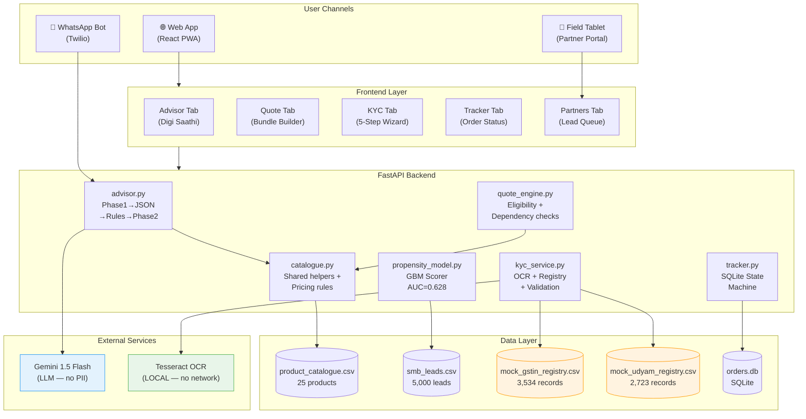
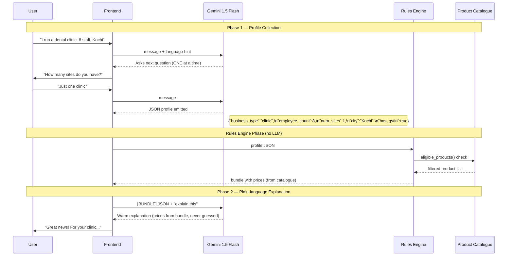
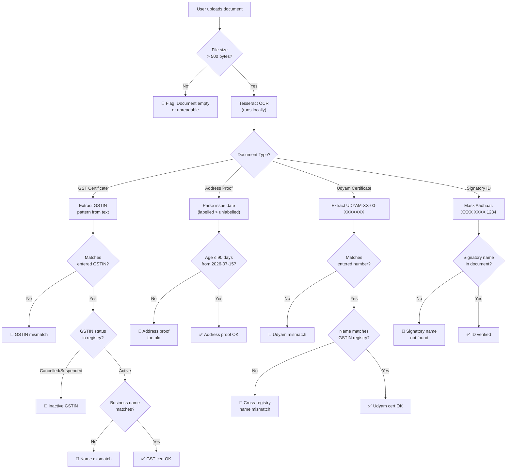
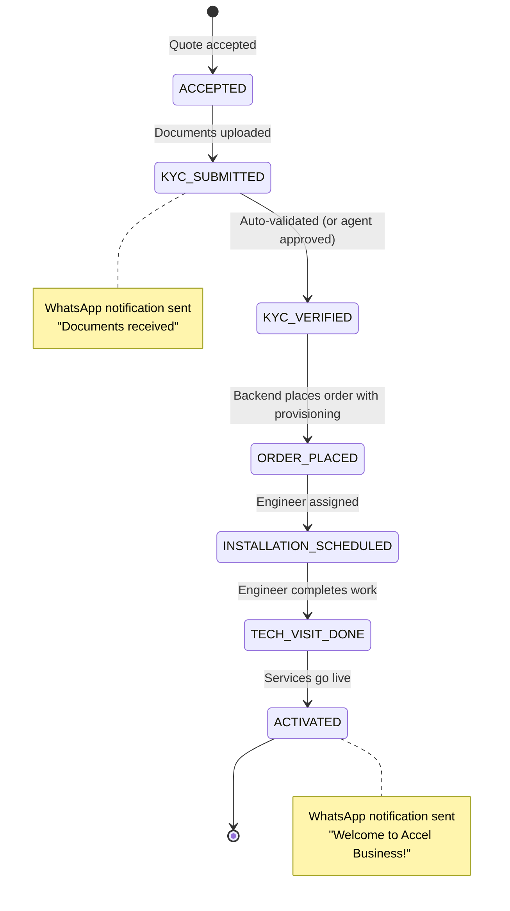

# 🏗️ Udyam Digital — Solution Architecture
### Accel Business · YTL Hackathon 2026

---

## High-Level System Architecture



---

## Two-Phase AI Advisor Architecture



> **Key Guarantee:** The LLM **never states a price**. All prices come from the rules engine reading the product catalogue CSV. This prevents hallucination and ensures accuracy.

---

## Smart KYC Validation Flow



---

## Order State Machine



---

## Propensity Scoring Model

```
Input Features (pre-outcome only — no leakage):
  ├── has_gstin_bin          (1/0)
  ├── has_udyam_bin          (1/0)
  ├── employee_count         (integer)
  ├── num_sites              (integer)
  ├── city_tier_bin          (1=Tier1, 2=Tier2)
  ├── monthly_telecom_spend  (₹/month)
  ├── segment_enc            (label encoded)
  ├── source_enc             (label encoded)
  └── state_enc              (label encoded)

Model: GradientBoostingClassifier
  n_estimators=200, max_depth=4, random_state=42
  Train/test split: 80/20 stratified
  AUC on held-out test set: 0.628
  Top-3 feature importances:
    1. monthly_telecom_spend_inr  (~40%)
    2. employee_count              (~20%)
    3. state_enc                   (~15%)

Output → Score 0–100, Priority (HIGH ≥15, MEDIUM ≥7, LOW <7)
```

---

## Technology Stack

| Layer | Technology | Version | Reason |
|-------|-----------|---------|--------|
| Frontend | React + Vite | 18.x / 5.x | Fast dev, tiny bundle (262KB) |
| Styling | TailwindCSS | 3.x | Utility-first, mobile responsive |
| HTTP client | Axios | 1.x | Clean promise API, interceptors |
| Backend | FastAPI | 0.111+ | Async, OpenAPI docs auto-generated |
| AI advisor | LangChain + Gemini 1.5 Flash | 1.x | Two-phase conversation, cheap & fast |
| OCR | Tesseract (pytesseract) | 0.3.13 | Local, no PII leaves server |
| ML model | scikit-learn GBM | 1.5+ | No leakage, AUC 0.628 |
| Database | SQLite (orders) | — | Zero-config, demo-ready |
| Data | Pandas | 2.x | CSV processing at startup |
| Containerisation | Docker + Compose | — | One-command deploy |
| Auth (prod) | OAuth 2.0 + JWT | — | Planned for production |

---

*Prepared for YTL Hackathon 2026 · Accel Business · All data synthetic*
